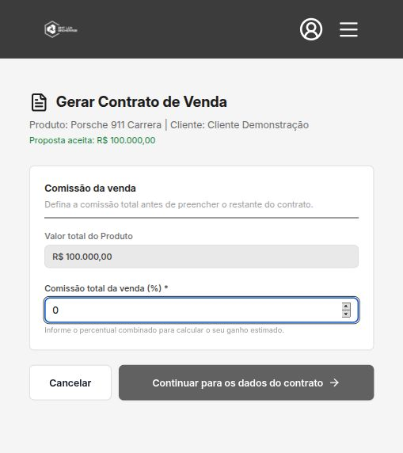
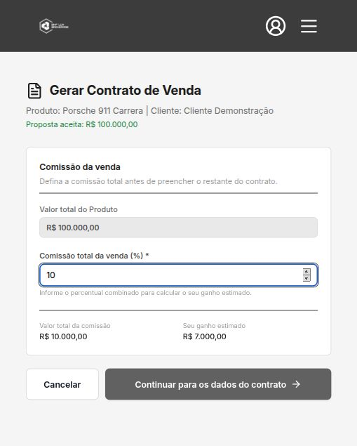

# Evidência E2E — valor total da comissão

Data: 14 de outubro de 2026

Fluxo validado na rota real `/specialist/contracts/new`, com autenticação e dados de prefill fornecidos por uma API local controlada.

## 1. Estado inicial

Com a porcentagem em `0`, a prévia financeira permanece oculta.

## 2. Resultado após o preenchimento

Ao informar `10%` sobre uma venda de `R$ 100.000,00`, a mesma seção exibe:

- Valor total da comissão: `R$ 10.000,00`
- Seu ganho estimado: `R$ 7.000,00`

O DOM foi verificado pelos rótulos e valores exatos, e o console do navegador não registrou erros nem avisos durante o fluxo.

