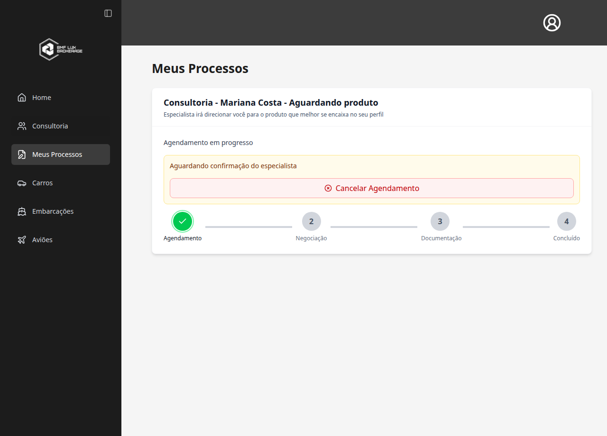
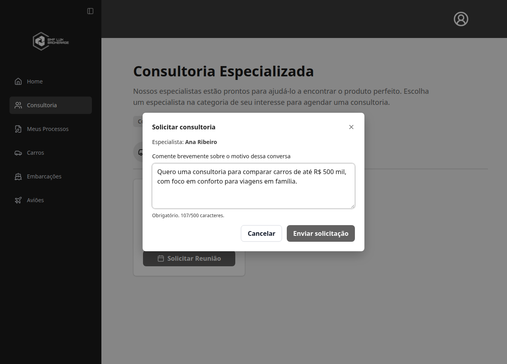
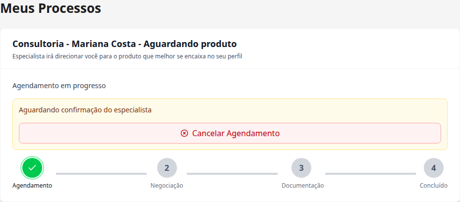
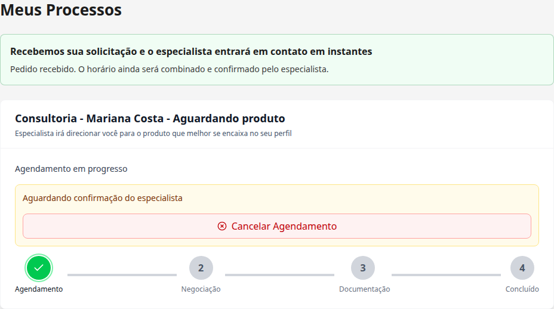
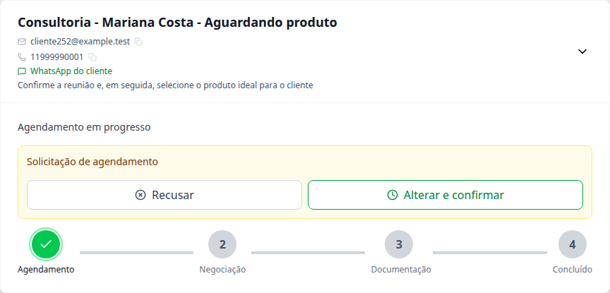
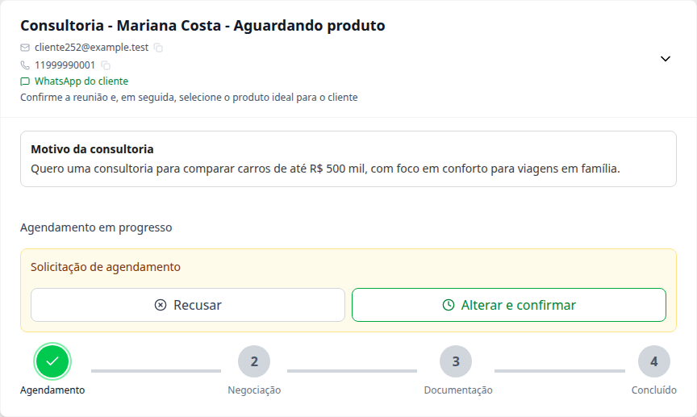

# Task #252 — antes e depois

Imagens capturadas no Chromium com o código real de cada versão, sem redesenhar as telas. Dados e respostas da API simulados; nenhum banco ou dado de produção foi alterado.

Antes: `develop` no commit `e4b76c4`. Depois: branch própria de cada task, sem combinar as tasks. Mesmos usuários fictícios, processo, horário, zoom e tamanho de tela em cada par. As respostas simuladas respeitam os campos retornados pela API de cada versão.

## 1. Ao clicar em Solicitar Reunião

**Antes:** o clique registrava a consultoria diretamente com uma nota genérica e levava a Meus Processos. Não havia campo para informar o motivo. **Depois:** o mesmo clique abre a janela de motivo antes de registrar o pedido; o restante da página continua sendo o existente.

| Antes — envio direto, sem motivo | Depois — coleta do motivo |
| --- | --- |
|  |  |

## 2. Confirmação para o cliente

**Antes:** Meus Processos mostrava o pedido pendente, sem o card de recebimento. **Depois:** aparece a confirmação de solicitação recebida, mantendo claro que o horário ainda está pendente.

| Antes | Depois |
| --- | --- |
|  |  |

## 3. Visão da especialista

**Antes:** a especialista recebia o processo sem a explicação do cliente. **Depois:** o mesmo card inclui a seção Motivo da consultoria.

| Antes | Depois |
| --- | --- |
|  |  |

[Ver o fluxo depois, passo a passo](fluxo.md).
