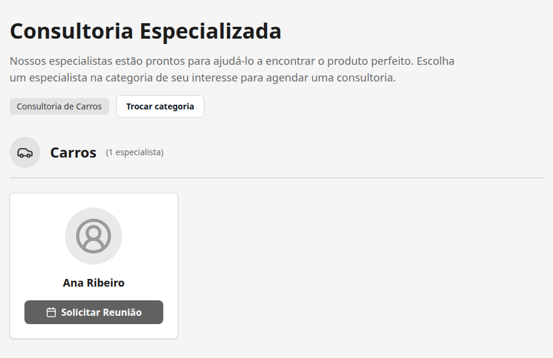
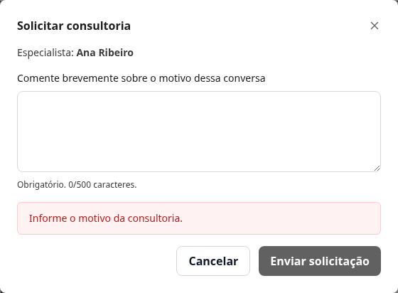
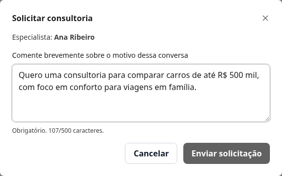
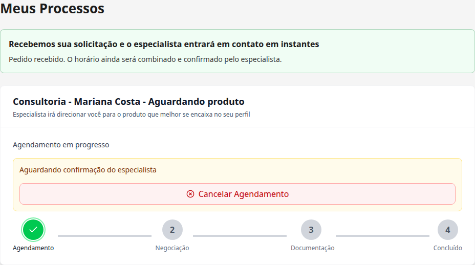
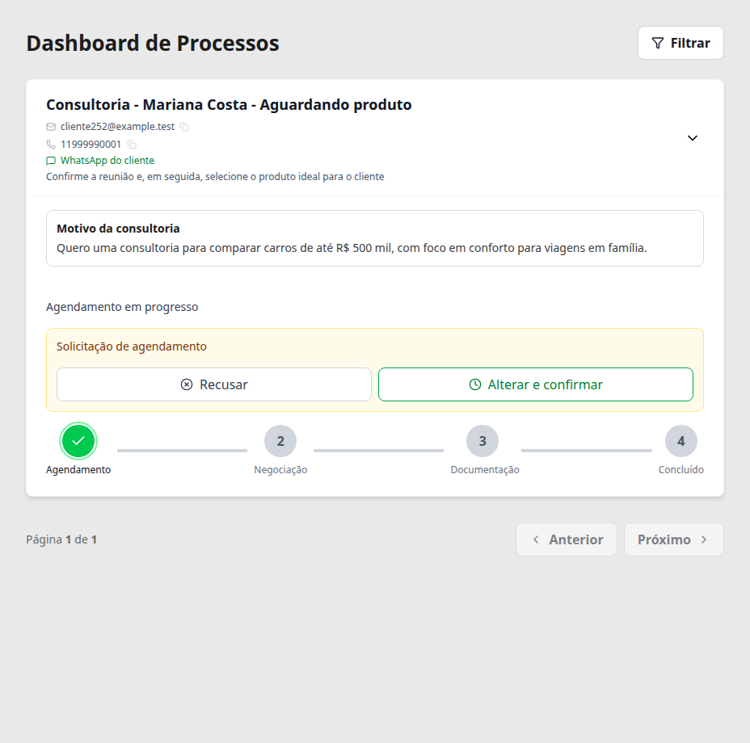

# Task #252 — Motivo da consultoria e confirmação de recebimento

[Ver comparação visual antes e depois](antes-e-depois.md).

Branch: `feat/consultancy-reason-252`.

Fluxo executado separadamente, na worktree desta task. Prints reais da aplicação local, com API e dados simulados. Não foi usado PostgreSQL real nem alterado qualquer dado de produção.

## 1. Cliente escolhe a especialista para a consultoria.

## 2. Motivo vazio é bloqueado antes de registrar o pedido.

## 3. Cliente informa o motivo, sem repetir nome ou e-mail.

## 4. Solicitação recebida; o horário continua aguardando confirmação.

## 5. A especialista encontra o motivo no processo, inclusive após recarregar.

## Verificações

Também foram conferidos o bloqueio de motivo vazio, o limite de 500 caracteres, o envio único e a leitura do motivo pelo especialista após recarregar.

Nenhum erro de JavaScript foi registrado durante este fluxo.
