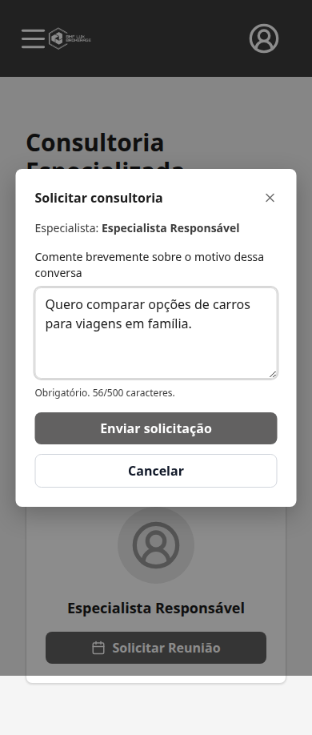
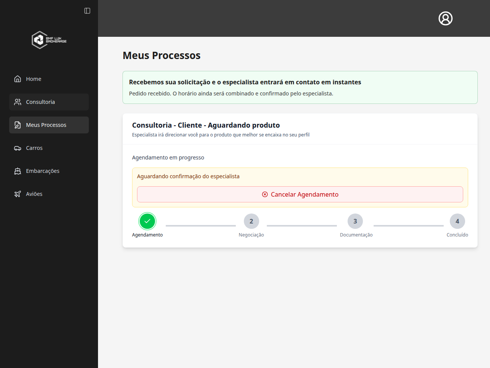

# Task #252 — motivo da consultoria e confirmação

Implementação em `feat/consultancy-reason-252`, criada de `origin/develop` no commit `e4b76c4d806083e77f05656700036f1ef4636972`.

## Comportamento

- “Solicitar Reunião” abre uma janela com o especialista escolhido e o campo “Comente brevemente sobre o motivo dessa conversa”. Abrir ou cancelar essa janela não cria pedido.
- O motivo é obrigatório, rejeita somente espaços e tem limite de 500 caracteres. A janela e o serviço frontend validam antes de enviar; o backend repete a validação antes de consultar/gravar dados. Envios concorrentes pela janela são bloqueados enquanto o primeiro está em andamento.
- O mesmo campo atende EMAIL e CALENDLY. Nome e e-mail vêm da conta. O preenchimento automático do Calendly é preservado; seus campos e asteriscos internos podem continuar obrigatórios, conforme alinhado com o usuário.
- O motivo é armazenado em `Appointment.notes`, sem duplicação em `Process.notes`. As respostas privadas de processos trazem `consultancy_reason`, derivado apenas do agendamento originalmente sem produto. Assim, a informação continua disponível após atribuir um produto ao processo.
- O painel real do especialista mostra “Motivo da consultoria” no card do processo. Registros sem motivo continuam legíveis e não recebem texto inventado. Nenhum registro antigo é regravado.
- Atualizar o status não permite substituir um motivo existente por uma observação diferente; a API orienta registrar o atendimento nas observações do processo. Conclusão sem `notes`, com o mesmo motivo após remover espaços, e anotações de agendamentos de produto continuam funcionando.
- A criação direta de agendamento continua proibida. As travas e a deduplicação do fluxo pendente são preservadas; uma repetição não sobrescreve o motivo de um pedido existente.

## Confirmação de recebimento

Após criar o pedido EMAIL, o cliente é redirecionado para Meus Processos. A página carrega os processos autorizados e só mostra “Recebemos sua solicitação e o especialista entrará em contato em instantes” quando o identificador do agendamento coincide com a resposta persistida e existe motivo de consultoria.

A confirmação distingue “Pedido recebido. O horário ainda será combinado e confirmado pelo especialista” de “Horário confirmado”. Pedidos CALENDLY pendentes, cancelados, processos rejeitados, identificadores diferentes, agendamentos de produto e falhas de carregamento não geram esse card de sucesso. A navegação normal para Meus Processos também não o gera.

No CALENDLY, o identificador para a confirmação só é transmitido após a sincronização bem-sucedida existente. Falhas de sincronização exibem uma mensagem de verificação pendente, sem afirmar que o horário foi confirmado. A lifecycle de fechamento, cancelamento, origem confiável e eventos tardios permanece protegida pelos testes existentes.

## Validação local

Executada em 25/10/2026, com serviços e persistência simulados nos testes:

| Comando | Resultado |
| --- | --- |
| Frontend: `npm test -- --maxWorkers=2` | 55 arquivos e **484 testes aprovados** |
| Backend: `env -u POSTGRES_CONCURRENCY_TEST_URL npm test -- --runInBand --silent '--testPathIgnorePatterns=\.postgres\.spec\.ts$'` | 69 suítes e **1.098 testes aprovados**, incluindo a correção das notas automáticas |
| Frontend: `npm run build` | Aprovado; aviso existente sobre tamanho do bundle |
| Backend: `npm run build` | Aprovado |
| Frontend: `npm run lint -- --quiet` | Zero erros |
| Backend: ESLint sem `--fix`, nos arquivos TypeScript alterados/adicionados, com `--quiet` | Zero erros |
| `git diff --check` | Aprovado |

A cobertura inclui motivo vazio/inválido/limite, normalização, envio único, falha preservando o texto para nova tentativa, EMAIL e CALENDLY, persistência sem misturar notas técnicas, deduplicação, projeções privadas e acesso de outro cliente, motivo após atribuição de produto e recarga, conclusão sem perda do motivo e ausência de falso sucesso.

## Limites e validação após publicação

- Nenhum banco remoto, objeto S3 ou e-mail real foi alterado pelos testes. Não houve migração de schema.
- As suítes `*.postgres.spec.ts` exigem configuração PostgreSQL dedicada e ficaram fora do comando unitário acima; esses resultados não representam validação de integração real com banco ou Calendly.
- O teste da implementação combinada com a #255 é registrado pela revisão principal.
- Após revisão, merge e deploy, conferir o fluxo publicado com um cliente e especialista de teste, pelos métodos EMAIL e CALENDLY, antes de encerrar a task.

## Revisão no navegador

- [Fluxo individual, com os prints e legendas](consultancy-reason-252-flow/fluxo.md).
- [Comparação antes e depois, lado a lado](consultancy-reason-252-flow/antes-e-depois.md).

Esses arquivos Markdown documentam a execução independente da #252, com o antes capturado na `develop` original e o depois na branch desta task. Dados e respostas da API simulados.

Chromium real, frontend local e API inteiramente interceptada com dados fictícios: **três cenários aprovados**, sem erros de JavaScript. O fluxo EMAIL foi conferido em desktop (1280 × 960) e celular (390 × 844), incluindo abertura sem criar pedido, bloqueio de somente espaços, limite de 500 caracteres, envio do motivo e confirmação em Meus Processos. O pedido pendente não mostra o card completo de contato. Uma falha simulada de criação mantém a página de consultoria, apresenta o erro e não exibe sucesso.

O Calendly real não foi acionado por essa revisão visual; a sincronização, seus estados e a preservação do preenchimento automático são cobertos nos testes automatizados com serviços simulados.

## Integração com #255

A aplicação da implementação #252 (`bca6550`) sobre o commit #255 (`d4767fc`) ocorreu sem conflitos textuais em checkout temporário. Nenhuma mudança foi integrada em `develop`.

- Frontend completo combinado: **57 arquivos, 507 testes aprovados**.
- Backend unitário combinado: **70 suítes, 1.110 testes aprovados**, com o mesmo comando que exclui `*.postgres.spec.ts`.
- Builds frontend e backend combinados aprovados; permanece o aviso de tamanho do bundle.
- Chromium combinado: **nove cenários aprovados**, incluindo formulário e recebimento desktop/mobile, falha de criação sem sucesso, contato confirmado, telefone ausente, rejeição, cancelamento, outro cliente e conclusão. Recarga de contato e ausência de transbordamento conferidas. Sem erros de JavaScript.
- API inteiramente simulada no navegador; nenhum dado remoto alterado.

As duas branches continuam independentes, originadas do mesmo commit de `develop`.

## Correção da revisão — notas automáticas

A revisão identificou que notas automáticas antigas eram expostas como se fossem o motivo informado pelo cliente. O helper agora retorna `consultancy_reason: null` para os textos padrão de solicitação e para as mensagens completas de criação por consultor ou gerente do escritório, com o timestamp gerado pelo sistema. O texto persistido permanece intacto.

A comparação reconhece os formatos automáticos completos, preservando motivos reais que apenas contêm palavras semelhantes. Não houve migração nem alteração de registros existentes.

Foram adicionadas regressões para os pedidos legados, os fallbacks de EMAIL/CALENDLY e o fluxo real de criação em nome do cliente por consultor/escritório. As projeções de detalhe, lista do especialista e lista do cliente foram verificadas com agendamento pendente, confirmado e concluído, inclusive após vincular um produto à consultoria.

- Antes da correção, as novas regressões reproduziram **12 falhas**.
- Após a correção: **4 suítes e 328 testes aprovados** (helper, projeções, processos e agendamentos).
- Verificação final da suíte unitária completa após a correção: **69 suítes e 1.098 testes aprovados**, excluindo `*.postgres.spec.ts`.
- Build do backend, ESLint nos arquivos TypeScript alterados e `git diff --check` aprovados.
- Validação com persistência simulada, sem PostgreSQL ou Calendly reais e sem alterações de produção.
