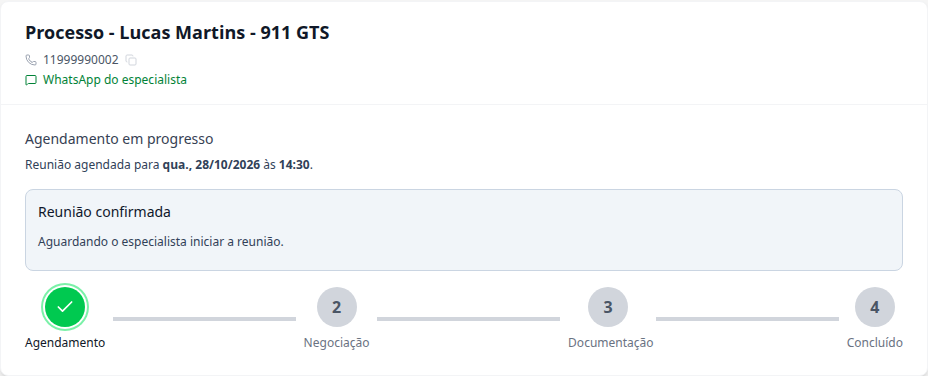
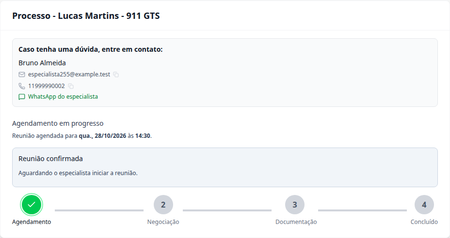
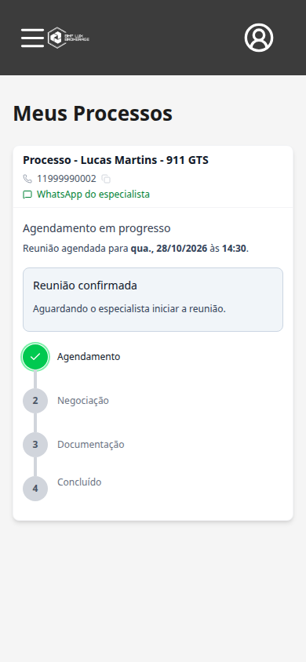
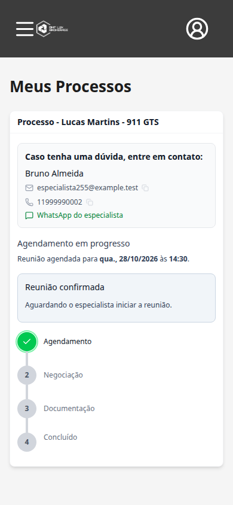

# Task #255 — antes e depois

Imagens capturadas no Chromium com o código real de cada versão, sem redesenhar as telas. Dados e respostas da API simulados; nenhum banco ou dado de produção foi alterado.

Antes: `develop` no commit `e4b76c4`. Depois: branch própria de cada task, sem combinar as tasks. Mesmos usuários fictícios, processo, horário, zoom e tamanho de tela em cada par. As respostas simuladas respeitam os campos retornados pela API de cada versão.

## 1. Mesmo processo, com horário já confirmado

**Antes:** o cabeçalho já tinha telefone copiável e WhatsApp, mas faltavam nome completo, e-mail e a mensagem de orientação. **Depois:** o contato fica em um card próprio, com nome completo, e-mail, telefone e as ações existentes. A estrutura do processo e suas etapas são preservadas.

| Antes — telefone no cabeçalho | Depois — card completo de contato |
| --- | --- |
|  |  |

## 2. A mesma comparação no celular

| Antes | Depois |
| --- | --- |
|  |  |

O card completo continua restrito ao cliente do processo após confirmação do agendamento. Telefone e WhatsApp já existiam; a task completa a identificação, acrescenta e-mail e organiza a apresentação do contato.

[Ver o fluxo depois, passo a passo](fluxo.md).
