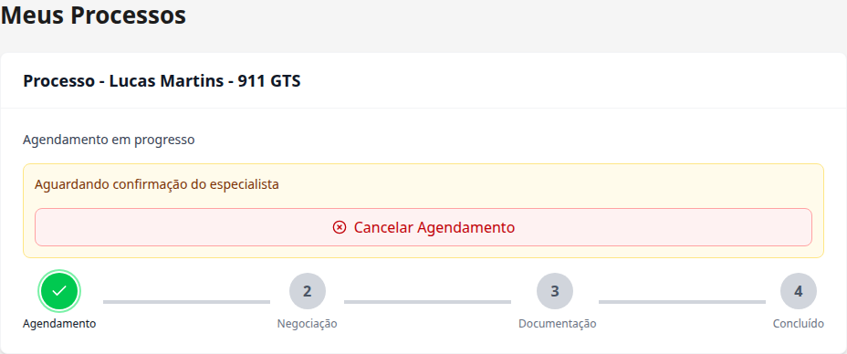
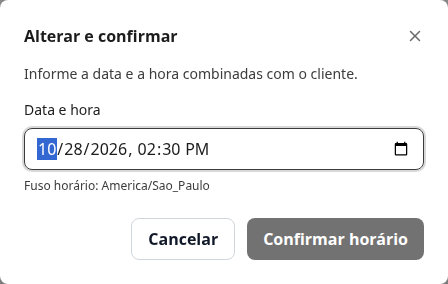
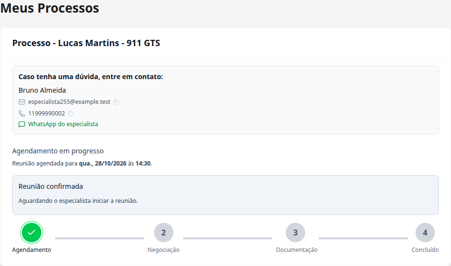
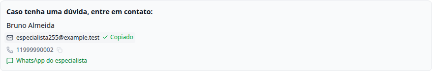

# Task #255 — Contato do especialista após confirmação do agendamento

[Ver comparação visual antes e depois](antes-e-depois.md).

Branch: `feat/specialist-contact-255`.

Fluxo executado separadamente, na worktree desta task. Prints reais da aplicação local, com API e dados simulados. Não foi usado PostgreSQL real nem alterado qualquer dado de produção.

## 1. Processo de produto existente: contato completo ainda oculto enquanto o horário está pendente.

## 2. Especialista informa a data combinada e confirma o horário.

## 3. Após confirmar o horário, cliente vê nome completo, e-mail, telefone, copiar e WhatsApp.

## 4. Copiar e-mail funciona no navegador; WhatsApp é conferido sem enviar mensagens.

## 5. Contato continua disponível após recarregar, também no celular.

## Verificações

Também foram conferidos a cópia do e-mail para a área de transferência, o link de WhatsApp sem envio de mensagem e a permanência do contato após recarregar, inclusive no celular.

Nenhum erro de JavaScript foi registrado durante este fluxo.
