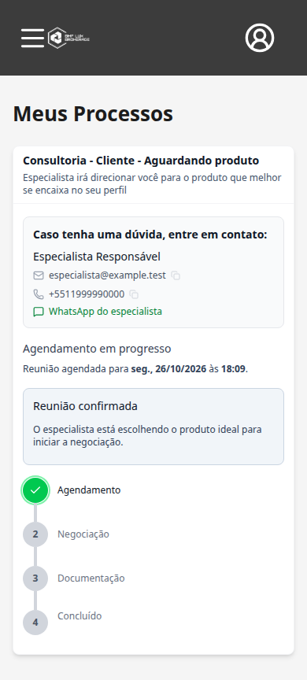
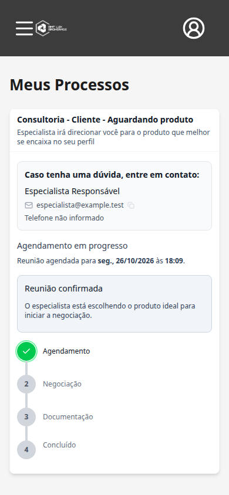

# Task #255 — Contato do especialista após confirmação

## Implementação

Base: `origin/develop`, commit `e4b76c4d806083e77f05656700036f1ef4636972`.
Branch: `feat/specialist-contact-255`.

Em **Meus Processos**, o cliente encontra o card “Caso tenha uma dúvida, entre em contato:” com nome completo, e-mail e telefone do especialista vinculado ao processo. O card reutiliza os controles de copiar e-mail/telefone e o link de WhatsApp já existentes.

O comportamento atende a consultorias e processos com produto, por `EMAIL` ou `CALENDLY`. Os dados são recuperados pela consulta dos processos, sem depender da resposta usada ao criar o agendamento.

### Visibilidade e dados ausentes

- E-mail e telefone são retornados somente para o `CUSTOMER` dono do processo quando o agendamento está `SCHEDULED` ou `COMPLETED`.
- Um processo `REJECTED` não libera os contatos, mesmo que o agendamento ainda esteja `SCHEDULED` ou `COMPLETED`.
- Agendamento `PENDING`, `CANCELLED` ou ausente não apresenta o card completo.
- Agendamento concluído mantém o contato durante negociação, contrato, documentação e conclusão do processo.
- A verificação ocorre tanto nas projeções privadas do backend (lista do cliente e detalhe) quanto na interface.
- A identidade vem de `process.specialist`; o especialista atual do anúncio não substitui o responsável pelo processo.
- Campos ausentes aparecem como “Nome do especialista não informado”, “E-mail não informado” e “Telefone não informado”. A ausência não bloqueia o processo.
- O fluxo operacional de e-mail para combinar um horário pendente permanece nas respostas e telas existentes de agendamento.
- O perfil público e o agrupamento público de especialistas não receberam campos privados.

## Validação automatizada local

Executada em 25/10/2026, com dependências locais e serviços/banco simulados nos testes. Nenhum banco remoto, objeto S3 ou envio de e-mail foi usado.

| Comando | Resultado |
| --- | --- |
| Frontend: `npm test -- --maxWorkers=2` | **55 arquivos, 483 testes aprovados** |
| Backend: `npm test -- --runInBand src/features/processes/specialist-contact.spec.ts src/features/processes/processes.service.spec.ts` | **2 arquivos, 191 testes aprovados** |
| Backend: `npm test -- --runInBand src/features/specialists/specialists.service.spec.ts src/features/appointments/appointments.service.spec.ts` | **2 arquivos, 140 testes aprovados** |
| Frontend: `npm run build` | Aprovado; aviso existente de bundle acima de 500 kB |
| Backend: `npm run build` | Aprovado |
| Frontend: `npm run lint -- --quiet` | Aprovado, zero erros |
| Backend: `npx eslint src/features/processes/processes.service.ts src/features/processes/entity/process.response.entity.ts src/features/processes/specialist-contact.spec.ts --quiet` | Aprovado, zero erros |
| `git diff --check` | Aprovado |

### Cenários cobertos

- Nome completo, e-mail, telefone, cópia e link de WhatsApp no card.
- Consultoria/produto, `EMAIL`/`CALENDLY`, agendamento confirmado/concluído.
- Contatos mantidos nas etapas posteriores à reunião.
- Não exposição para outro cliente, anônimo, especialista, consultor, administrador ou escritório.
- Processo rejeitado com agendamento confirmado/concluído; agendamento cancelado, pendente ou inexistente.
- Dados privados antigos indevidamente presentes na resposta não fazem a interface mostrar o card em estados sem permissão.
- Campos ausentes, telefone inválido para WhatsApp e ausência do especialista sem fallback para outra pessoa.
- Página real de Meus Processos integrada ao `ProcessCard`, com o formato de resposta da API que contém o cliente em `client.id`.
- Uma nova montagem da página consulta novamente a API e mantém o contato correto.
- Regressões de processos, agendamentos e projeção pública do especialista.

## Limites e validação final

Os testes usam mocks dos serviços de persistência e da API; não comprovam deploy nem comportamento de dados existentes no ambiente publicado. A publicação e a conferência no ambiente publicado permanecem etapas posteriores.

## Revisão no navegador

- [Fluxo individual, com os prints e legendas](specialist-contact-255-flow/fluxo.md).
- [Comparação antes e depois, lado a lado](specialist-contact-255-flow/antes-e-depois.md).

Esses arquivos Markdown documentam a execução independente da #255, com o antes capturado na `develop` original e o depois na branch desta task. O cenário usa um processo de produto existente; não depende do fluxo novo da #252. Dados e respostas da API simulados.

Chromium real, frontend local e API totalmente interceptada com dados fictícios: **seis cenários aprovados**, sem erros de JavaScript. Foram verificados contato confirmado, telefone ausente, processo rejeitado, agendamento cancelado, outro cliente e processo concluído. Os cenários com contato também foram conferidos após recarregar a página, em viewport de 390 × 844, sem transbordamento horizontal.

## Integração com #252

A aplicação da implementação #252 (`bca6550`) sobre o commit #255 (`d4767fc`) ocorreu sem conflitos textuais em checkout temporário. Nenhuma mudança foi integrada em `develop`.

- Frontend completo combinado: **57 arquivos, 507 testes aprovados**.
- Backend unitário combinado: **70 suítes, 1.110 testes aprovados**; comando com `--testPathIgnorePatterns=\.postgres\.spec\.ts$`, excluindo integrações que exigem PostgreSQL dedicado.
- Builds frontend e backend combinados aprovados; permanece o aviso de tamanho do bundle.
- Chromium combinado: **nove cenários aprovados**, cobrindo o fluxo de motivo/recebimento e as regras de contato acima, sem erros de JavaScript. API inteiramente simulada.

As duas branches continuam independentes, originadas do mesmo commit de `develop`. A integração real com PostgreSQL dedicado e Calendly e a conferência no ambiente publicado não foram executadas.
